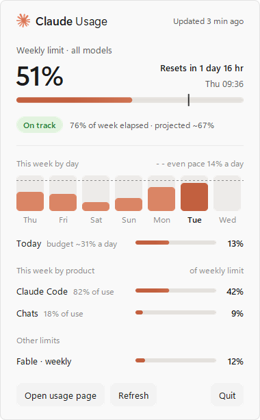
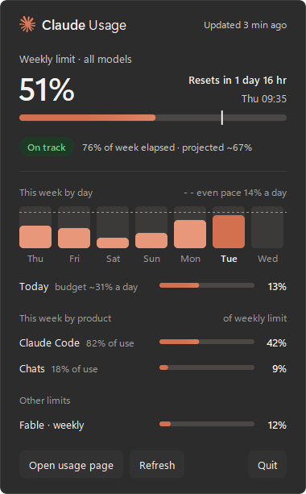

# Claude Usage Widget — Windows

A Windows taskbar widget that shows your [claude.ai](https://claude.ai) plan limits at a glance, so you see a limit coming before you hit it.

<p align="center">
  
  &nbsp;
  
</p>
<p align="center">
  <br>
  <sub>The panel (light and dark) and the strip on the taskbar, with example data.</sub>
</p>

A small strip sits on the taskbar: `51% until Tue`, with a bar. The mark on the bar shows how much of the week has gone, so you can see at a glance whether you are ahead of it. Click the strip to open the panel:

- **Weekly limit**: the 7-day limit across all models, when it resets, and your pace — `On track`, `Tight` or `Over pace`, from the share of the week gone and the projected end-of-week usage
- **This week by day**: a column for each day of the weekly window, with a dashed line at an even pace (~14% a day). The widget keeps its own history of your weekly % (`%LOCALAPPDATA%\claude-usage-widget\history.json`), so the chart fills in from the day you start it; a day it did not see shows `–`
- **Today**: today's budget — the limit that is left, spread evenly over the days that are left — and how much of it you used today. The bar turns red when you go over
- **This week by product**: how much of the weekly limit each product used. claude.ai reports each product's share of your usage; the panel shows that share of your weekly % (with 5% used and Claude Code at 100% of use, Claude Code shows 5%), and the share itself as a small note. Claude Code and Chats always show; Cowork and Other only once you use them
- **Other limits**: the separate weekly Fable limit (only if your plan has one) and extra usage (only when it is on)
- **Open usage page**, **Refresh** and **Quit** buttons

Bars turn **red at 90%**. The strip and the panel follow the Windows light/dark setting.

Hover the strip, the weekly bar, a day column or the Today row for a tooltip with the details. The panel slides in, its bars fill and its numbers count up; the strip moves smoothly to new data. Turn off **Settings › Accessibility › Visual effects › Animation effects** and the widget shows everything at once, without motion.

> **Unofficial.** Not affiliated with Anthropic. It reads the same internal endpoint the claude.ai settings page uses, which can change without notice.

This is a Windows port of [sdezubiria's macOS widget](https://github.com/sdezubiria/claude-usage-widget). The macOS parts (Keychain, launchd, Übersicht) are replaced with Windows equivalents: DPAPI / Credential Manager, Task Scheduler, and a tkinter window.

---

## How it works

There are two ways to get usage data, depending on your browser. Both end with the same `usage_data.json` that `widget.py` draws, refreshing itself whenever the file changes.

**A. Chrome extension (recommended for Chrome / Edge / Brave)** — a tiny extension fetches usage from inside the browser using your live login, so no cookie file is ever read:

```
Chrome extension ──▶ claude.ai usage API
       │
       ▼ (POST)
  receiver.py ──▶ usage_data.json ──▶ widget.py
```

**B. Cookie / paste (good for Firefox-family, or any browser via a pasted key)**:

```
Browser cookies (Firefox, Zen, …)  ──┐
                                      ├─▶ fetch_usage.py ──▶ claude.ai usage API ──▶ usage_data.json ──▶ widget.py
Saved key (Credential Manager/DPAPI) ─┘
```

`fetch_usage.py` and `receiver.py` share the same parsing code, so the widget schema is defined once. Your login never leaves your machine except to talk to claude.ai. Requests use [`curl_cffi`](https://github.com/lexiforest/curl_cffi) so Cloudflare lets them through.

> **Which should I use?** On Chrome/Edge, use **A** — Windows keeps the Chrome cookie file exclusively locked while the browser runs, and Chrome 127+ encrypts cookies so an outside program can't read them. The extension sidesteps both. On Firefox/Zen/LibreWolf/Floorp, **B** works silently with zero extra setup.

---

## Requirements

| | |
|---|---|
| **Windows 10/11** | Uses DPAPI and Task Scheduler |
| **Python 3.10+** | Check with `py --version`. tkinter ships with the python.org installer |
| **A browser logged in to claude.ai** | See [Supported browsers](#supported-browsers) |

---

## Install with the setup file (no Python needed)

`installer\ClaudeUsageWidget-Setup.exe` installs the widget for your Windows user (no admin prompt) to `%LOCALAPPDATA%\Programs\Claude Usage Widget`. It is the extension method in one program: the receiver and the widget run together in `ClaudeUsageWidget.exe`.

1. Run `ClaudeUsageWidget-Setup.exe`. Keep **Start the widget when I sign in to Windows** ticked if you want it at logon.
2. Load the extension once: open `chrome://extensions` (or `edge://extensions`), turn on **Developer mode**, click **Load unpacked**, and select the `extension` folder in the install folder. The Start Menu has a **Chrome extension folder** shortcut to it.
3. Start **Claude Usage Widget** from the Start Menu. Right-click the widget to quit; that also stops the receiver.

Uninstall from **Settings → Apps → Installed apps**.

**Build the setup file yourself:** install [Inno Setup 6](https://jrsoftware.org/isinfo.php) (`winget install -e --id JRSoftware.InnoSetup`), then run `build_installer.bat`. It bundles `app.py` with PyInstaller and packs it with `installer.iss`.

---

## Quick start

Install the Python dependencies once, for either method:

```bash
pip install -r requirements.txt
```

### One-click start (Windows, extension method)

Once the one-time setup is done (Python, `pip install`, and the extension loaded as in Method A below), these two files are all you need:

| File | What it does |
|---|---|
| **`Start Widget.cmd`** | Starts `receiver.py` and `widget.py` in the background. A small window shows for a few seconds, then closes. Safe to double-click again: it skips whatever is already running. |
| **`Stop Widget.cmd`** | Stops both. (Right-clicking the widget closes just the widget.) |

**Start at logon:** press **Win+R**, type `shell:startup`, Enter. In the folder that opens, right-click → **New → Shortcut**, point it at `Start Widget.cmd`, then open the shortcut's **Properties** and set **Run** to **Minimized** so no window flashes at sign-in.

### Method A — Chrome extension (recommended for Chrome/Edge/Brave)

1. **Load the extension.** Open `chrome://extensions`, turn on **Developer mode** (top-right), click **Load unpacked**, and select this project's `extension` folder. (In Edge use `edge://extensions`; in Brave `brave://extensions`.)
2. **Start the receiver** — it writes `usage_data.json` whenever the extension pushes data:
   ```bash
   py receiver.py
   ```
   Or run it in the background with `start_receiver.bat`, or at logon with
   `powershell -ExecutionPolicy Bypass -File install_task.ps1 -Receiver`.
3. **Show the widget:**
   ```bash
   py widget.py
   ```

Steps 2 and 3 are exactly what `Start Widget.cmd` does for you, so after loading the extension once you can just double-click that.

Make sure you're logged in to claude.ai in that browser. The extension refreshes every 5 minutes on its own. To push sooner, click **Refresh** in the widget's panel: the extension picks the request up within 30 seconds. Check its logs via the extension's **service worker** link.

After you update the project, open `chrome://extensions` and click the widget's **reload** button, so Chrome runs the new extension code.

### Method B — cookie / paste (Firefox-family, or any browser)

1. **Connect your account.** Log in to claude.ai, then:
   ```bash
   py fetch_usage.py --setup
   ```
   It finds and tests a login, or asks you to paste your `sessionKey` (see [Paste your key](#paste-your-key-the-universal-method)).
2. **Keep it fresh** — a Scheduled Task that runs at logon, every 5 minutes:
   ```bash
   powershell -ExecutionPolicy Bypass -File install_task.ps1
   ```
   Or run `start.bat` to fetch in the background without a task.
3. **Show the widget:** `py widget.py`

### The widget

Click (or right-click) the strip to open the panel; click anywhere else or press **Esc** to close it. Drag the strip to move it. **Quit** is in the panel. Leave it running — it picks up new data on its own. To start it at logon with the extension method, use the `Start Widget.cmd` Startup shortcut described under [One-click start](#one-click-start-windows-extension-method). With the cookie/paste method, put a shortcut to `widget.py` (opened with `pythonw.exe`) in the same Startup folder instead: press **Win+R**, type `shell:startup`, and drop the shortcut there.

---

## Supported browsers

Windows handles browser cookies very differently from macOS, so read this.

| Family | Browsers | On Windows |
|---|---|---|
| **Firefox** | Firefox, Zen, LibreWolf, Floorp | **Works silently.** Cookies are plain text and not locked; expired logins renew on the next run. Recommended. |
| **Chromium** | Chrome, Edge, Brave, Vivaldi, Chromium | **Only while the browser is closed**, and only on older versions. Chrome/Edge keep the cookie file **exclusively locked while running**, and version 127+ add *app-bound encryption* that an ordinary program can't decrypt. When that happens, use Firefox-family or paste your key. |
| **Other** | Safari (N/A), Arc, anything else | Paste your key once (below). |

The key takeaway: on a typical Chrome/Edge setup the widget **cannot** read your cookie automatically. That's a Windows + Chrome security limitation, not a bug. For Chrome/Edge/Brave, use the **[browser extension](#method-a--chrome-extension-recommended-for-chromeedgebrave)** (fully automatic). Otherwise use a **Firefox-family browser** or **paste your key once**.

To limit the search to one browser: `py fetch_usage.py --setup --browser firefox` (names: `firefox zen librewolf floorp chrome edge brave vivaldi chromium`). For the background fetcher, set the environment variable `CLAUDE_BROWSER` instead. To see what was detected without using it: `py fetch_usage.py --browsers`.

### Paste your key (the universal method)

1. Open claude.ai and open DevTools (**F12**).
2. Go to **Application → Storage → Cookies → https://claude.ai**.
3. Copy the value of `sessionKey`.
4. Run `py fetch_usage.py --setup` and paste it when asked.

The key is saved for your Windows user (see [Where your key is stored](#where-your-key-is-stored)) and reused every run. Pasted keys can't renew themselves — when the widget says your session expired, repeat these steps.

---

## Where your key is stored

The `sessionKey` is never written to disk in plain text:

- If the optional [`keyring`](https://pypi.org/project/keyring/) package is installed (`pip install keyring`), it goes into **Windows Credential Manager** (Control Panel → Credential Manager → Windows Credentials, under `claude.ai`).
- Otherwise it's saved to `%LOCALAPPDATA%\claude-usage-widget\session.bin`, **encrypted with DPAPI** so only your Windows account can read it back.

Either way, another user account on the PC can't read it.

---

## The pace

The week starts 7 days before the weekly limit resets. The panel compares your usage with the share of the week that has gone, and projects where you will end the week at the same rate:

| Projected | Shows |
|---|---|
| up to 90% | **On track** |
| 91–100% | **Tight** |
| over 100% | **Over pace** — at this rate you hit the limit before it resets |

In the first ~5 hours of a week it shows **New week**, because a projection is not useful yet. To change the thresholds, edit `week_pace()` in `widget.py`. Colors live in the `LIGHT` and `DARK` dicts at the top of the same file.

---

## Configuration

| What | How |
|---|---|
| **Strip / panel width** | `STRIP_W`, `PANEL_W` at the top of `widget.py` (px at 100% display scaling; the widget scales them for you) |
| **Keep clear of the clock** | `TRAY_MARGIN` (px reserved on the right for the system tray) — the widget can't be dragged past it |
| **"Updated" warning** | `STALE_MIN`: the panel's "Updated … ago" turns amber when the data is older than this |
| **Remembered position** | The widget reopens where you last dragged it (`%LOCALAPPDATA%\claude-usage-widget\widget_pos.json`), clamped so it can't hide behind the taskbar or slide into the tray. Delete that file to reset to the default spot |
| **Use one browser only** | `--browser NAME`, or set `CLAUDE_BROWSER=NAME` |
| **Fetch interval** | `py fetch_usage.py --loop 120` (seconds). Default is 300 |
| **Manual values** | `py set_usage.py` asks for each value — handy for testing the UI |

### `usage_data.json`

The widget reads this file:

```json
{
  "plan": "Max",
  "weekly":  { "percent": 54, "resets_in": "2d 7h", "resets_at": "2026-10-03T19:00:00Z" },
  "fable":   { "percent": 92, "resets_in": "7h", "resets_at": "2026-10-01T19:00:00Z", "available": true },
  "extra":   { "enabled": true, "spent": 0.0, "percent": 0, "limit": 12.0, "resets": "1st of month" },
  "products": [ { "key": "claude_code", "name": "Claude Code", "percent": 92 },
                { "key": "chat", "name": "Chats", "percent": 8 } ],
  "updated": "2026-10-01T11:41:48"
}
```

---

## Troubleshooting

**The widget shows old numbers / "updated Xh ago" keeps growing** — check the log:

```bash
Get-Content fetch.log -Tail 20
```

**Using the extension and nothing updates** — check, in order:

- Is `receiver.py` running? Its window prints a line each time the extension pushes. If the extension logs `is receiver.py running?`, start it (`Start Widget.cmd` does this).
- Is another program using port 8765? The receiver takes the port for itself and stops with `Port 8765 is already in use` when something else holds it. Find the program with `netstat -ano | findstr :8765`, stop it, then start the receiver again.
- Open `chrome://extensions` → the widget's **service worker** link → Console. `logged in to claude.ai?` means log in; a receiver error means the receiver isn't reachable on `127.0.0.1:8765`.
- Click the service worker **reload** to push immediately instead of waiting 5 minutes.

Cookie/paste method:

- `cookies are locked`: Chrome/Edge is running. Use the extension instead, switch to a Firefox-family browser, or paste your key.
- `app-bound encryption`: your Chromium browser is version 127+. Use Firefox-family or paste your key.
- `Session expired`: log in to claude.ai again (Firefox-family renews automatically), or re-run `--setup` and paste a fresh key.
- `Blocked by Cloudflare`: usually temporary; clears on a later run.

**`py` isn't recognized** — install Python from [python.org](https://www.python.org/downloads/windows/) (not the Microsoft Store stub) and tick *Add python.exe to PATH*. Then use `py` or `python`.

**Restart the background fetcher**

```bash
Start-ScheduledTask -TaskName ClaudeUsageWidget
```

---

## Project layout

```
widget.py           taskbar strip and usage panel (tkinter + Pillow)
docs/               screenshots for this README
usage_data.json     written by either method, read by the widget

Method A (Chrome extension)
  extension/         unpacked MV3 extension — load this folder in chrome://extensions
  receiver.py        local endpoint that the extension POSTs usage to
  Start Widget.cmd   one click: start receiver.py + widget.py (skips what's already running)
  Stop Widget.cmd    stop both
  start_receiver.bat run only the receiver in the background

Method B (cookie / paste)
  fetch_usage.py     fetches usage and writes usage_data.json
  browser_cookies.py finds claude.ai logins (Firefox plaintext, Chromium DPAPI+AES-GCM)
  credential_store.py saves the sessionKey (Credential Manager or DPAPI file)
  windpapi.py        thin ctypes wrapper around Windows DPAPI
  start.bat          run the fetcher without Task Scheduler

Installer
  app.py             receiver + widget in one process (the .exe entry point)
  build_installer.bat  PyInstaller + Inno Setup → installer\ClaudeUsageWidget-Setup.exe
  installer.iss      Inno Setup script

Shared
  set_usage.py       enter values by hand (UI testing)
  install_task.ps1   register the background component as a Scheduled Task
                     (fetch_usage by default; -Receiver for the extension method)
  uninstall_task.ps1 remove it
```

---

## License

[MIT](LICENSE) — same as the upstream project.
